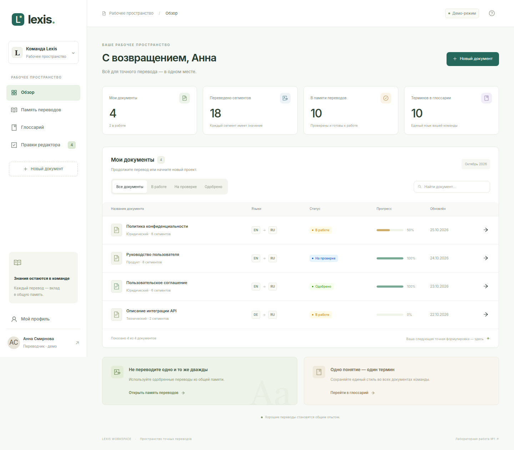

# Lexis — кабинет переводчика

Внутренняя платформа переводческой команды: документы, единая память переводов, терминологическая база и редакторские правки. Переводчик работает с оригиналом и переводом по сегментам, редактор проверяет формулировки, команда переиспользует согласованные термины и одобренные переводы.

**Текущий этап: лабораторная №1 — интерфейс и каркас frontend.** Реализованы девять экранов на демонстрационных данных. Backend, база данных и настоящая авторизация появятся в следующих лабораторных.



## Запуск

Требования: Node.js 22.12+ (или 20.19+), npm. Проверено на Node.js 24.

```bash
cd frontend
npm ci
npm run dev
```

Откройте http://localhost:5173. Если порт занят, Vite выведет другой адрес. Приложение сразу доступно без входа; на `/login` есть кнопка «Открыть демо без входа».

```bash
npm run build      # строгая проверка TypeScript и production-сборка
npm run preview    # просмотр production-сборки на http://localhost:4173
npm run test:e2e   # браузерные проверки и обновление скриншотов
```

Для браузерных проверок нужен Chrome: по умолчанию `/opt/google/chrome/chrome`. На другой машине задайте путь:

```bash
CHROME_PATH=/usr/bin/google-chrome npm run test:e2e
```

Playwright сам запускает dev-сервер, если он ещё не запущен. Скриншоты сохраняются в `docs/screenshots/`, диагностические файлы — в игнорируемый `frontend/test-results/`. Для размещения production-сборки сервер должен отдавать `index.html` для неизвестных путей: маршрутизация выполняется браузером.

## Роли и сценарии

| Роль | Сценарий |
| --- | --- |
| Переводчик | Обзор → новый документ → оригинал и языковая пара → редактор → перевод и подсказки → сохранение → отправка на проверку |
| Редактор | Очередь правок → сравнение оригинала и перевода → версия редактора и комментарий → одобрение или возврат |
| Обе роли | Поиск в памяти переводов; поиск, добавление, изменение и удаление терминов; просмотр профиля |

Роли в ЛР1 показывают сценарии интерфейса. Они не ограничивают доступ; все экраны доступны для демонстрации. При смене роли меняется подпись профиля.

## Экраны

| Маршрут | Экран | Скриншот |
| --- | --- | --- |
| `/login` | Вход, валидация email и пароля, переход в демо | [Вход](docs/screenshots/01-login.png) |
| `/register` | Регистрация, выбор роли, проверка совпадения паролей | [Регистрация](docs/screenshots/02-register.png) |
| `/` | Статистика, поиск и фильтрация документов, переход в редактор | [Обзор](docs/screenshots/03-dashboard.png) |
| `/documents/new` | Название, языки, тематика, текст оригинала | [Новый документ](docs/screenshots/04-document-new.png) |
| `/documents/:id` | Сегменты в двух колонках, подсказки, термины, сохранение и отправка | [Редактор](docs/screenshots/05-editor.png) |
| `/tm` | Поиск по оригиналу/переводу и фильтр языковой пары | [Память переводов](docs/screenshots/06-tm.png) |
| `/glossary` | Термины, поиск и тематика, модальная форма, подтверждение удаления | [Глоссарий](docs/screenshots/07-glossary.png) |
| `/reviews` | Очередь, редактирование версии и комментария, одобрение и возврат | [Правки](docs/screenshots/08-reviews.png) |
| `/profile` | Демоимя, email, роль | [Профиль](docs/screenshots/10-profile.png) |

Неизвестный маршрут показывает 404. Неизвестный идентификатор документа — сообщение и переход к списку.

## Что можно проверить

1. В обзоре откройте «Политика конфиденциальности». Выберите поле перевода сегмента 5. Справа появится соответствующая демонстрационная подсказка. Нажмите «Использовать перевод», затем «Сохранить переводы». Вернитесь к обзору и снова откройте документ: перевод сохранён в текущей сессии.
2. Создайте документ с коротким текстом. Текст станет одним демосегментом. Переведите его, сохраните и отправьте на проверку. Статус и прогресс обновятся, редактор переключится в режим просмотра. Неполный перевод отправить нельзя.
3. В памяти найдите `encrypted` или `шифруются`. Поиск работает по обоим языкам. Несуществующая фраза показывает пустое состояние; `DE → RU` также пуст, поскольку исходная демопамять содержит только `EN → RU`.
4. В глоссарии добавьте `release → релиз`, найдите термин, измените перевод и удалите с подтверждением. Дубли исходного термина в одной тематике запрещены.
5. В правках измените версию редактора и одобрите карточку. Для возврата нужен комментарий. Вкладка «Все правки» сохраняет обработанные карточки в текущей сессии.

**Границы демо:** состояние хранится в React Context (`useState`). Переходы между страницами сохраняют его; перезагрузка страницы сбрасывает. Пароли не сохраняются и не проверяются сервером; вход с любым валидным по форме email и паролем от 8 символов открывает демо. Не вводите реальные секреты. Проценты совпадения и подсказки заданы в mock-данных, алгоритма поиска похожести и AI нет. Очередь правок демонстрирует отдельный сценарий: отправка документа не создаёт новые карточки и не обновляет TM. Полный связанный процесс — ЛР2–5.

## Стек и структура

React 19, TypeScript 5 (strict), Vite 7, React Router 7, **Ant Design 5**, `@ant-design/icons`. Точные версии зафиксированы в `frontend/package-lock.json`.

Ant Design выбран из-за готовых `Form`, `Table`, `Modal`, `Drawer`, `Tag`, `Progress`, `Statistic`, валидации и русской локализации. Общая тема задаётся один раз в `ConfigProvider`. Собственный CSS задаёт компоновку, типографику и адаптивность. Иконки и иллюстрация на экране входа работают локально, внешние шрифты и изображения не требуются.

```text
frontend/
  src/
    main.tsx              # Тема, локализация, провайдеры
    app/
      router.tsx          # Клиентские маршруты
      layouts.tsx         # AuthLayout и AppLayout, меню
      store.tsx           # Общее состояние демосессии
      styles.css          # Оформление и media queries
    pages/                # Компоненты девяти экранов
    shared/
      types/              # User, Doc, Segment, TmEntry, Term, Review
      mocks/              # Реалистичные типизированные демонстрационные данные
      ui/                 # Заголовки, статусы, языковые пары
  tests/workspace.spec.ts # Пользовательские сценарии и скриншоты
docs/
  screenshots/            # Все экраны + мобильный/планшетный виды
  defense.md              # Краткий разбор для защиты
```

Это начальная модульная структура. `entities` и `features` появятся при развитии архитектуры в ЛР3, пустые каталоги заранее не создаются. Данные: 4 документа (8 сегментов в основном), 10 записей памяти, 10 терминов, 4 правки. Статистика вычисляется по состоянию.

## Адаптивность и проверка

На 1440 px меню раскрыто, редактор — две колонки и боковая панель подсказок. На 768 px меню свёрнуто до иконок, оригинал и перевод остаются рядом, подсказки размещаются ниже. На 360 px меню открывается кнопкой в `Drawer`, сегменты и формы становятся одноколоночными. Широкие таблицы прокручиваются внутри своего контейнера. [Обзор 360](docs/screenshots/dashboard-360.png), [редактор 360](docs/screenshots/09-editor-360.png), [обзор 768](docs/screenshots/dashboard-768.png), [редактор 768](docs/screenshots/09-editor-768.png).

Проверки Playwright охватывают все девять экранов на 360/768/1440 px, отсутствие горизонтального переполнения страницы, мобильное меню, навигацию, создание и сохранение перевода, подсказки, запрет отправки неполного документа, поиск/пустое состояние TM, CRUD глоссария, обработку правок, регистрацию/вход и отсутствующие страницы. При обходе экранов дополнительно проверяются ошибки JavaScript.

## Связь с ML-планом

Перед реализацией изучены методичка `src.md`, предложенный `PLAN.md`, уточняющее ТЗ `lab_01/task_01.md` и личный `ML_plan.md` (направление Junior AI / LLM / Agent Engineer). Учебная часть строит детерминированный full-stack фундамент: сейчас интерфейс, далее FastAPI + PostgreSQL + SQLAlchemy, авторизация и интеграция. Документы, термины и одобренные сегменты станут предметной базой будущего RAG-проекта.

LLM, Qdrant, Langfuse и MCP остаются после MVP, как предлагает план. ЛР1 не требует PostgreSQL в Compose, поэтому настройка БД отложена до ЛР2. Профиль добавлен по дорожной карте сверх восьми экранов детального ТЗ. Решение о соответствии курсу и согласовании темы остаётся за преподавателем; наличие фронтенда само по себе не означает сдачу следующих работ.

## Журнал интерфейса

- **25.10.2026 · ЛР1:** реализован единый светлый интерфейс Lexis с зелёными акцентами, постоянным меню, двумя layout, девятью экранами и типизированной демосессией.
- **25.10.2026 · Адаптивность:** на планшете подсказки перенесены под сегменты для читаемости двух колонок; на телефоне меню заменено на Drawer, редактор и формы — на одну колонку. Скриншоты приложены.
- Существенные изменения последующих лабораторных фиксируются здесь с причиной и обновлёнными скриншотами.

## Перед сдачей

- [x] Назначение, сценарии, экраны и запуск описаны.
- [x] React + TypeScript, готовая UI-библиотека и клиентский роутинг.
- [x] Все основные экраны и демонстрационные данные.
- [x] Скриншоты экранов и адаптивные варианты.
- [x] `.gitignore`, без API-ключей и паролей в исходном коде.
- [ ] Доступный преподавателю Git-репозиторий и фиксация результата (см. ограничение ниже).

По договорённости загрузку в Git выполняет автор проекта самостоятельно. Исходные файлы и скриншоты готовы к добавлению в репозиторий. После переноса используйте `git add` и осмысленный коммит; дальнейшие лабораторные фиксируйте по завершении этапов. Не создавайте искусственную историю разработки задним числом.
